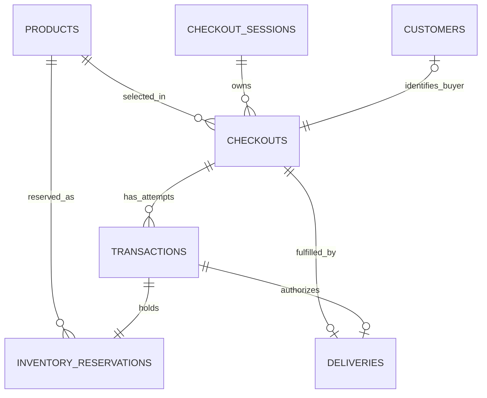

# Payment Checkout

Assessment de compra de un producto: catálogo y stock, comprador/entrega, resumen,
pago con tarjeta en sandbox y resultado con inventario actualizado. Orientado a
móvil y recuperable al refrescar.

## Estado actual

| Implementado                                                            | Propuesto / pendiente                          |
| ----------------------------------------------------------------------- | ---------------------------------------------- |
| NestJS 11, PostgreSQL 17, TypeORM 1.1.3; migraciones y seed idempotente | Inicio/finalización del pago y reservas        |
| Money COP, catálogo y disponibilidad                                    | Wompi sandbox, idempotencia y reconciliación   |
| Sesión guest/CSRF; crear, guardar y recuperar borrador; resumen         | SPA React y recorrido de cinco pantallas       |
| Helmet, validación, Swagger, pruebas unitarias/SQL/e2e                  | Cobertura global >80 %, Linux y despliegue AWS |

Frontend acordado: React + TypeScript + Vite, Redux Toolkit/React Redux,
React Hook Form/Zod, CSS Modules y Flexbox/Grid, Jest/React Testing Library.
Backend conserva @nestjs/config, class-validator/class-transformer, Swagger,
Helmet y neverthrow. No hay aplicación desplegada ni URL pública disponible.

## Ejecutar localmente (Windows / PowerShell)

Requisitos: Node.js 24, npm, Git y Docker Desktop con contenedores Linux.
La base se verificó con Node 24.11.1 y npm 11.6.2. Desde la raíz:

```powershell
# Solo la primera vez; no sobrescribir un .env existente
Copy-Item .env.example .env
docker compose up -d db
docker compose ps
Set-Location backend
npm ci
# Generar un secreto y configurar CSRF_SECRET en el .env raíz antes de arrancar:
node -e "console.log(require('node:crypto').randomBytes(32).toString('hex'))"
npm run migration:run
npm run seed:products
npm run start:dev
```

Esperar a `db` healthy. API: <http://localhost:3000>, Swagger:
<http://localhost:3000/docs>, OpenAPI: <http://localhost:3000/docs-json>.
Swagger incluye catálogo y las cinco operaciones de sesión/borrador/resumen. Pagos pendientes.
Ctrl+C detiene NestJS. PostgreSQL usa `127.0.0.1:5433` desde Windows y volumen
persistente; `docker compose stop db` lo detiene desde la raíz sin borrar datos.

| Variable obligatoria | Regla / ejemplo local                                                                   |
| -------------------- | --------------------------------------------------------------------------------------- |
| DB_HOST              | Texto no vacío; 127.0.0.1                                                               |
| DB_PORT              | Entero 1..65535; 5433                                                                   |
| DB_NAME              | Texto no vacío; payment_checkout                                                        |
| DB_USER              | Texto no vacío; checkout                                                                |
| DB_PASSWORD          | Definir en .env; ejemplo solo local                                                     |
| PORT                 | Entero 1..65535; 3000                                                                   |
| CSRF_SECRET          | Secreto propio de al menos 32 caracteres; conservar entre reinicios                     |
| FRONTEND_ORIGINS     | Orígenes exactos separados por coma; local: http://localhost:3000,http://localhost:5173 |

Nest busca .env del directorio de ejecución y después del padre; variables del
proceso tienen prioridad. Compose lee el .env raíz. No versionar secretos.
CSRF_SECRET se exige al componer el módulo de checkout. FRONTEND_ORIGINS acepta
HTTPS o HTTP de localhost/loopback en desarrollo; NODE_ENV=production exige HTTPS.
La cookie usa Secure con el origen HTTPS permitido y solo omite Secure en HTTP
local. En AWS inyectar el secreto y el origen HTTPS real; no usar valores locales.
Aún no hay CORS para un navegador Vite separado: usar mismo origen/proxy cuando
se implemente el frontend.
Cambiar .env no cambia credenciales de un volumen PostgreSQL ya inicializado.
Se conservan synchronize=false y migrationsRun=false: el arranque no crea tablas
ni ejecuta migraciones. CLI y seed reutilizan validación y precedencia de entorno,
incluyendo .env UTF-8 con BOM de Windows. Linux no se ha verificado como runtime
del backend; PostgreSQL sí se ejecuta en contenedor Linux.

## Probar catálogo en Swagger

Con la API arrancada, abrir <http://localhost:3000/docs> y desplegar **products**:

1. GET `/api/v1/products`: Try it out -> Execute. Devuelve todos los productos
   activos, incluidos los agotados, sin paginación. limit, cursor y filtros se
   rechazan con 400 INVALID_QUERY_PARAMS, no se ignoran.
2. GET `/api/v1/products/{id}`: usar `11111111-1111-4111-8111-111111111111`
   (auriculares) o `22222222-2222-4222-8222-222222222222` (parlante).
3. Un identificador `invalid-id` devuelve 400; el UUID
   `bbbbbbbb-bbbb-4bbb-8bbb-bbbbbbbbbbbb` devuelve 404. No requiere sesión.

Productos ficticios para sandbox, definidos para una tienda de tecnología.
Los diez productos y categorías son decisiones del proyecto, no requisitos
textuales del PDF. Datos locales al verificar:

| SKU     | Producto                       | Categoría         | Centavos COP | COP    | Disponible |
| ------- | ------------------------------ | ----------------- | ------------ | ------ | ---------- |
| AUD-001 | Auriculares inalámbricos Nova  | audio             | 12990000     | 129900 | 10         |
| AUD-002 | Parlante portátil Pulse        | audio             | 17990000     | 179900 | 5          |
| COM-001 | Teclado mecánico K68           | computacion       | 18990000     | 189900 | 12         |
| COM-002 | Mouse inalámbrico Ergo         | computacion       | 7990000      | 79900  | 18         |
| COM-003 | Cámara web Full HD Focus       | computacion       | 11990000     | 119900 | 10         |
| ACC-001 | Cargador USB-C de 65 W         | accesorios        | 9990000      | 99900  | 20         |
| ACC-002 | Hub USB-C de seis puertos      | accesorios        | 14990000     | 149900 | 14         |
| ALM-001 | SSD portátil de 1 TB           | almacenamiento    | 32990000     | 329900 | 8          |
| HOG-001 | Bombillo inteligente Wi-Fi RGB | hogar-inteligente | 4990000      | 49900  | 25         |
| HOG-002 | Enchufe inteligente Wi-Fi      | hogar-inteligente | 5990000      | 59900  | 16         |

La disponibilidad se calcula desde stock menos reservas HELD: excluye las
vencidas NOT_SENT y conserva las comprometidas IN_FLIGHT/SUBMITTED/UNKNOWN.
Es una consulta, no crea reservas ni descuenta inventario. Imagen y SKU también
se devuelven. Money solo representa/valida centavos enteros COP entre 0 y
2000000000; el precio del producto debe ser positivo. El resumen usa multiplicación
y suma comprobadas de Money; rechaza overflow antes de serializar números.

## Probar compra recuperable (PowerShell)

Con el backend arrancado, ejecutar en **otra terminal**. Datos ficticios; las
cookies y el CSRF permanecen en memoria de esta terminal, sin imprimirlos:

```powershell
$base = 'http://localhost:3000/api/v1'
$origin = 'http://localhost:3000'
$guest = Invoke-RestMethod -Method Post -Uri "$base/checkout-sessions" -Headers @{ Origin = $origin } -SessionVariable checkoutCookies
$headers = @{ Origin = $origin; 'X-CSRF-Token' = $guest.data.csrfToken }
$body = @{ productId = '11111111-1111-4111-8111-111111111111'; quantity = 2 } | ConvertTo-Json
$draft = Invoke-RestMethod -Method Post -Uri "$base/checkouts" -WebSession $checkoutCookies -Headers $headers -ContentType 'application/json' -Body $body
$checkoutId = $draft.data.id
$body = @{
  buyer = @{ fullName = 'Cliente Ejemplo'; email = 'cliente@example.test'; phone = '+573000000000' }
  delivery = @{ recipientName = 'Cliente Ejemplo'; phone = '+573000000000'; addressLine1 = 'Calle de ejemplo 1'; city = 'Bogotá'; region = 'Bogotá D.C.'; country = 'CO' }
} | ConvertTo-Json -Depth 4
$utf8Body = [System.Text.Encoding]::UTF8.GetBytes($body)
$saved = Invoke-RestMethod -Method Patch -Uri "$base/checkouts/$checkoutId" -WebSession $checkoutCookies -Headers $headers -ContentType 'application/json; charset=utf-8' -Body $utf8Body
$recovered = Invoke-RestMethod -Uri "$base/checkouts/$checkoutId" -WebSession $checkoutCookies
$summary = Invoke-RestMethod -Uri "$base/checkouts/$checkoutId/summary" -WebSession $checkoutCookies
$summary | ConvertTo-Json -Depth 4
```

Resultado para dos auriculares: quantity=2, unitPriceCents=12990000,
subtotalCents=25980000, baseFeeCents=50000, deliveryFeeCents=100000,
totalCents=26130000, currency=COP. Cada tarifa se aplica una vez.

Para comprobar recuperación, detener/reiniciar NestJS en su terminal conservando
.env/CSRF_SECRET y PostgreSQL. En la terminal del recorrido conservar las variables:

```powershell
$again = Invoke-RestMethod -Method Post -Uri "$base/checkout-sessions" -Headers @{ Origin = $origin } -WebSession $checkoutCookies
if ($again.data.expiresAt -ne $guest.data.expiresAt) { throw 'La sesión cambió' }
$restored = Invoke-RestMethod -Uri "$base/checkouts/$checkoutId" -WebSession $checkoutCookies
if ($restored.data.id -ne $checkoutId -or $restored.data.buyer.email -ne 'cliente@example.test') { throw 'No se recuperó el borrador' }
$other = Invoke-RestMethod -Method Post -Uri "$base/checkout-sessions" -Headers @{ Origin = $origin } -SessionVariable otherCookies
try {
  Invoke-RestMethod -Uri "$base/checkouts/$checkoutId" -WebSession $otherCookies
  throw 'Se permitió acceso ajeno'
} catch {
  if ($null -eq $_.Exception.Response -or [int]$_.Exception.Response.StatusCode -ne 404) { throw }
  'Acceso desde otra sesión: 404'
}
```

La sesión dura 24 h sin renovarse. GET no escribe; recuperar requiere cookie e ID.
PATCH acepta quantity y/o objetos completos buyer/delivery, solo en DRAFT.
Comprador y destino se guardan juntos bajo lock SQL; clientes no se comparten por
email. Un borrador no reserva ni descuenta stock ni crea entregas. Resumen
incompleto devuelve 422; con intento activo/aprobado lee sus importes históricos.
No hay aún rutas para crear dichos intentos. Véase el contrato para errores.

## Migraciones y seed

Desde backend, contra la DB indicada por las variables de entorno:

```powershell
npm run migration:generate -- src/infrastructure/database/migrations/NombreDelCambio
npm run migration:run
npm run seed:products
npm run migration:revert
```

Generar compara las entidades con la base seleccionada; revisar el SQL antes de
versionarlo. Revertir deshace la última migración y puede eliminar columnas/datos: usar
una base descartable para comprobarlo. La inicial crea las siete tablas del modelo;
no aplica reglas de compra ni procesa pagos. AddProductCategory1795643379559 añade
category y transforma una sola vez los dos productos originales, conservando sus
UUID/stock. Si detecta presentación personalizada o colisión de SKU, aborta la
migración completa con CATALOG_TRANSITION_CONFLICT; no sobrescribir ni borrar para
resolverlo automáticamente. El seed inserta los diez por ID/SKU y nunca actualiza
existentes después de esa transición. Se conservan productos ajenos, reservas e
históricos. Revertir la migración de categoría no deshace precios/SKU de productos.

Las diez imageUrl de placehold.co fueron comprobadas por HTTP el 2026-11-25:
200, image/png, 800×600. Son **placeholders con texto**, no fotografías ni
representaciones físicas de los productos. Las imágenes reales quedan pendientes;
no se agregó generación ni subida de archivos.

## Pruebas y cobertura

Desde backend, con PostgreSQL healthy para integración y e2e:

```powershell
npm run format:check
npm run lint:check
npm run build
npm test -- --runInBand
npm run test:e2e -- --runInBand
npm run test:integration
npm run test:cov -- --runInBand
```

Para arrancar compilado: `npm run build` y `npm run start:prod`. Verificado en
Windows con PostgreSQL 17 de Docker: **117 unitarias, 23 integración y 28 e2e**.
Las unitarias prueban configuración, dinero y casos de uso; integración comprueba
restricciones/seed y repositorio de borradores; e2e comprueba HTTP de catálogo y
sesión/compra. Integración/e2e crean bases aleatorias
payment_checkout_test_<aleatorio>, migran, inicializan y eliminan solo su propia
base. Requieren CREATEDB; no limpian DB_NAME. El recorrido e2e comprueba
Origin/CSRF, sesión vencida, validaciones, acceso ajeno, rollback, bloqueo de
compras, importes históricos y recuperación al recrear la aplicación. No procesa
pagos. La CLI se verificó en Windows, no en Linux/AWS.

La DB local conserva InitialSchema1795632838292 y AddProductCategory1795643379559.
Esta etapa reutiliza sus tablas sin cambiar migraciones, dependencias ni seed.

La prueba exige **más del 80 % en frontend y backend por separado**; meta >=85 %
en statements, branches, functions y lines. Medición unitaria del 2026-11-25,
base de catálogo c387681a + bloque de sesión/borrador/resumen, con
`npm test -- --runInBand --coverage --coverageReporters=text`:

| Alcance                                             | Statements | Branches | Functions | Lines   |
| --------------------------------------------------- | ---------- | -------- | --------- | ------- |
| Backend global, todo src con exclusiones existentes | 24,39 %    | 35,14 %  | 33,33 %   | 24,85 % |
| Nuevo dominio checkout.ts                           | 98,41 %    | 98,36 %  | 100 %     | 98,36 % |
| Nuevos casos de uso checkout-cases.ts               | 100 %      | 100 %    | 100 %     | 100 %   |
| Money (incluidas suma/multiplicación)               | 100 %      | 100 %    | 100 %     | 100 %   |
| Nuevos HTTP/TypeORM y composición (unitaria)        | 0 %        | 0 %      | 0 %       | 0 %     |

El >80 % global sigue **pendiente**. No se incluyen integración/e2e en esas
métricas; tampoco se cambiaron exclusiones. Money y los casos ListProducts y
GetProduct tienen 100 % en sus cuatro métricas. Los adaptadores nuevos se prueban
por integración/e2e y no suman a esta medición unitaria; módulos, DTOs, entidades,
migraciones y adaptadores siguen incluidos en el denominador. Frontend aún no existe y no
tiene cobertura; no se le atribuye la del backend.
Escenarios previstos: dinero/overflow, estados, stock concurrente, doble clic,
idempotencia, aprobado/rechazado, timeout/sync, eventos repetidos, refresh e IDOR.

## API y modelo persistido

[Contrato API](docs/api-contract.md) y [OpenAPI exportado](docs/openapi.json): catálogo, sesión, checkout/resumen,
transacciones/pay/sync y webhook. Clientes/destino se capturan por checkout;
no necesitan CRUD públicos. Productos ficticios mediante seed idempotente.



[Modelo detallado](docs/data-model.md): compra distinta de intento; un intento
activo, importes y datos históricos congelados, stock/reservas y entrega solo al
aprobar. Money valida los importes del catálogo sin framework. Los índices PostgreSQL
aportan restricciones de unicidad. PATCH bloquea su checkout y guarda cliente y
destino en una sola transacción. Coordinar cobro/inventario/entrega y comparar
hashes de los intentos sigue pendiente.

## Arquitectura y recorrido

[Flujo y decisiones](docs/checkout-flow.md): producto -> tarjeta/entrega -> resumen
-> resultado -> producto actualizado. Catálogo, Checkout, Payments y Fulfillment
en un monolito hexagonal: dominio puro, casos de uso con Result/ResultAsync de
neverthrow, puertos y adaptadores TypeORM/Wompi. Controllers sin lógica de negocio;
NestJS conecta implementaciones.

Para el checkout futuro, sin versiones/TTL de cotizaciones: crear intento compara el resumen
aceptado con el cálculo actual y lo congela. Stock se reserva atómicamente antes
del cobro. Timeout incierto conserva reserva y bloquea otro envío: webhook y sync
comparten finalización. Refresh recupera estado desde backend con sesión propia;
Redux persistido guarda como máximo IDs/paso, nunca tarjeta o tokens.

## AWS y limitaciones

Se mantiene la propuesta AWS: backend en ECS Fargate, PostgreSQL en RDS y SPA en
S3/CloudFront, mismo origen con /api para backend. No se cambia de proveedor ni
de arquitectura de despliegue; aún falta implementar y verificar Linux, HTTPS,
secretos inyectados, TLS/conectividad DB y coste. No hay URLs desplegadas.

Para este assessment no hay scheduler/leases: sync mientras la UI está abierta,
webhook y revisión manual. Si nadie vuelve y no llega evento, un pago incierto
puede retener stock hasta revisar; no se declara resuelto por quitar los jobs.
Recuperar sin ID remoto requiere verificar capacidades UAT; nunca reenviar por
un timeout o liberar por un not-found aislado. También quedan por validar
contratos/auth/firma/límites en UAT y confirmar tarifas ficticias propuestas.
Solo datos ficticios; política de retención y operación con datos reales quedan
fuera de este alcance. No hay triggers de inmutabilidad: sus garantías mediante
futuros casos de uso/repositorios aún están pendientes, sin protección frente a
SQL privilegiado.
