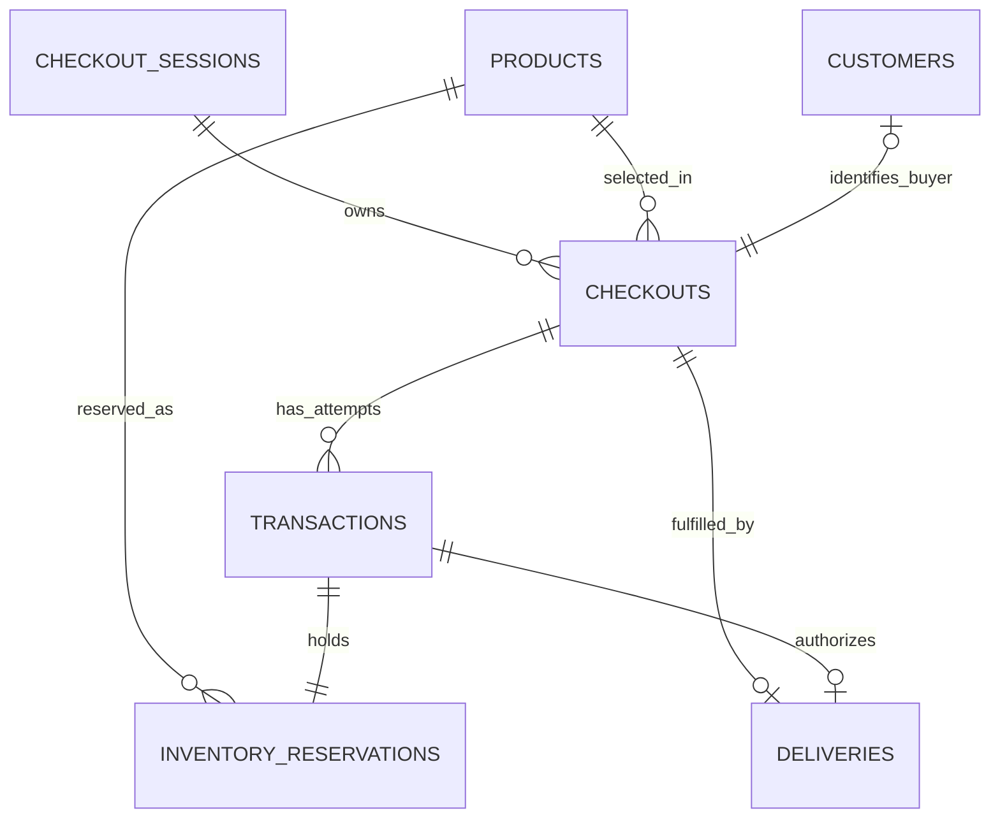

# Nodo — checkout con tarjeta

Construí una tienda de tecnología con un checkout recuperable y pagos con tarjeta
mediante un proveedor de pagos en Sandbox. Puedes explorar productos, elegir
unidades, completar comprador y entrega, revisar el total y consultar el resultado
o tus compras.
La API verifica el pago y coordina inventario, reserva y entrega en PostgreSQL.
La aplicación y Swagger están publicados en AWS con HTTPS, usando únicamente Sandbox.

## Enlaces para evaluar

- [Repositorio público](https://github.com/Jhon32-hue/nodo-checkout).
- [Aplicación pública conectada a la API](https://hq1tzuevc3.execute-api.us-east-2.amazonaws.com).
- [Swagger público](https://hq1tzuevc3.execute-api.us-east-2.amazonaws.com/docs).
- [OpenAPI versionado](docs/openapi.json) y [contrato HTTP](docs/api-contract.md).
- [Ejecución local](#ejecución-local) y [pruebas/cobertura](#pruebas-y-cobertura).

## Probar una compra Sandbox

Usa exclusivamente datos ficticios y las [tarjetas oficiales de Sandbox](https://docs.wompi.co/docs/colombia/datos-de-prueba-en-sandbox/):

- Aprobación: **4242 4242 4242 4242**.
- Rechazo: **4111 1111 1111 1111**.
- Fecha de expiración futura y CVC ficticio de tres dígitos, por ejemplo **123**.

La ayuda del formulario permite elegir el escenario. El frontend no fabrica
la aprobación o el rechazo: tokeniza con el proveedor y consulta nuestra API.

1. Abre un producto, elige cantidad y pulsa **Pagar con tarjeta de crédito**.
2. Completa Tarjeta, Comprador y Entrega en el modal; acepta por separado los
   dos contratos enlazados. Navegar entre pasos no cobra.
3. Revisa producto, cantidad, subtotal, tarifa base, entrega y total en el
   resumen sobre backdrop. Todos los importes proceden del servidor.
4. Confirma el pago: la SPA tokeniza directamente con Wompi; la API crea el
   intento `PENDING` y su reserva antes de solicitar el cobro.
5. La API verifica el resultado. Una aprobación confirma la reserva, descuenta
   stock y registra una entrega; un rechazo confirmado libera la reserva.
6. Consulta el resultado y vuelve al inicio con el catálogo actualizado.
   Puedes recargar y consultar **Mis compras** mientras conserve la sesión.

Si el resultado es incierto, consulta su estado; no repitas el cobro.
Las tarifas son ficticias: base de 500 pesos y entrega de 1000 pesos por compra.
La configuración del backend debe tener credenciales válidas del UAT de la prueba.

## Funciones principales

- Diez productos iniciales, cinco categorías, búsqueda local y detalle.
- Carrito con varios productos y cantidades independientes. **Cada línea se
  compra por separado**: no existe «Pagar todo» ni una transacción combinada.
- El subtotal del carrito es estimado; las tarifas definitivas corresponden
  al resumen del servidor para el producto elegido.
- Recuperación de borradores e intentos; historial y detalle de la sesión invitada.
- Tras aprobar se retira solo la línea comprada y se consultan catálogo e historial.

## Stack y arquitectura

| Área     | Tecnologías implementadas                                        |
| -------- | ---------------------------------------------------------------- |
| Frontend | React, TypeScript, Vite, Redux Toolkit/React Redux y Material UI |
| API      | NestJS 11, TypeScript, casos de uso, puertos y adaptadores       |
| Datos    | PostgreSQL 17 y TypeORM 1.1.3                                    |
| Pagos    | Wompi UAT Sandbox; cifrado/tokenización desde la SPA             |
| Pruebas  | Jest en ambos proyectos; integración PostgreSQL y e2e separadas  |

La SPA usa Redux siguiendo Flux para catálogo, carrito, progreso y vistas públicas.
React Hook Form/Zod gestionan el formulario; CSS Modules, Flexbox/Grid y Material UI
resuelven la presentación. La SPA consulta la API; solo la tokenización va directamente
al proveedor. La API persiste en PostgreSQL y envía/consulta los cobros en Wompi.

En backend, dominio y aplicación no dependen de TypeORM ni HTTP. Los casos de uso
componen `Result`/`ResultAsync` de neverthrow; controllers, stores y gateway son
adaptadores conectados por NestJS. Helmet y ValidationPipe protegen la entrada HTTP.
Más detalle en [arquitectura y recorrido](docs/checkout-flow.md).

## Modelo de datos



Cada checkout contiene un producto y cantidad, un comprador propio y un destino.
Puede conservar varios intentos históricos, con una reserva por intento y una
entrega al aprobar. Los importes se conservan en centavos enteros COP; el catálogo
no altera los importes de una compra anterior. [Tablas y restricciones](docs/data-model.md).

## API

Rutas bajo `/api/v1`; las operaciones privadas exigen la sesión propietaria.

| Operación               | Rutas principales                                                        |
| ----------------------- | ------------------------------------------------------------------------ |
| Catálogo                | `GET /products`, `GET /products/:id`                                     |
| Sesión y borrador       | `POST /checkout-sessions`, `POST /checkouts`, `GET/PATCH /checkouts/:id` |
| Resumen y configuración | `GET /checkouts/:id/summary`, `GET /payments/config`                     |
| Intentos e historial    | `POST /transactions`, `GET /transactions`, `GET /transactions/:id`       |
| Cobro y consulta remota | `POST /transactions/:id/pay`, `POST /transactions/:id/sync`              |

## Seguridad y recuperación

PAN, CVC, token y datos cifrados no se guardan en Redux, storage, PostgreSQL ni logs.
En el navegador, comprador y entrega viven en memoria del formulario/coordinador;
el backend sí los persiste en PostgreSQL para recuperar el checkout autorizado.
La transacción conserva los importes y snapshots históricos necesarios.

`localStorage` guarda el carrito como `productId`/cantidad y el puntero de progreso
con IDs, paso y clave de idempotencia. La cookie `checkout_session` es HttpOnly,
SameSite=Lax, Secure bajo HTTPS y dura 24 horas sin renovación. Un UUID no da acceso.
Perder la cookie impide acceder al historial; no elimina registros ni permite
recuperación entre dispositivos. Un puntero obsoleto requiere una acción explícita.

La API confirma `PENDING`/reserva y después el claim de envío antes del HTTP al
proveedor. Locks, restricciones e idempotencia evitan efectos duplicados. `UNKNOWN`
mantiene reserva y bloqueo; `sync` consulta un intento enviado, nunca crea un cobro.
[Estados, almacenamiento y diagnóstico de solo lectura](docs/checkout-flow.md).

## Ejecución local

Requisitos verificados: Node.js 24, npm, Git y Docker Compose con PostgreSQL 17.
Los comandos son para PowerShell desde la raíz; no sobrescribas un `.env` existente.

```powershell
Copy-Item .env.example .env
docker compose up -d db
docker compose ps
cd backend
npm ci
npm run migration:run
npm run seed:products
npm run start:dev
```

Antes de arrancar, configura en `.env`: `DB_HOST`, `DB_PORT`, `DB_NAME`, `DB_USER`,
`DB_PASSWORD`, `PORT`, `CSRF_SECRET` y `FRONTEND_ORIGINS`.
Para pagar añade `WOMPI_BASE_URL`, `WOMPI_PUBLIC_KEY`, `WOMPI_PRIVATE_KEY` y
`WOMPI_INTEGRITY_SECRET`, obtenidas por un canal privado para el UAT autorizado.
`CSRF_SECRET` debe tener al menos 32 caracteres y conservarse entre reinicios.
No copies credenciales al repositorio. El entorno del proceso tiene prioridad
sobre `.env` del directorio de ejecución y el del padre.

Espera a que PostgreSQL esté healthy. El seed es idempotente y no restablece stock
consumido. Migraciones y seed usan la base seleccionada: no los repitas sobre una
compra de desarrollo que quieras conservar. `synchronize` y `migrationsRun` siguen
en `false`. [Detalles de migración](docs/data-model.md#migración-y-seed-implementados).

En otra terminal, desde la raíz:

```powershell
cd frontend
npm ci
npm run dev
```

Abre `http://localhost:5173`. Vite usa 5173 y envía `/api` al backend en 3000;
incluye ese origen exacto en `FRONTEND_ORIGINS`. PostgreSQL local usa 5433.
Swagger local: <http://localhost:3000/docs>; OpenAPI local: <http://localhost:3000/docs-json>.
Si Windows necesita su almacén de certificados, configura `NODE_USE_SYSTEM_CA`
en el proceso del backend; conserva TLS validado. La imagen Linux de la API está
verificada en ECS Fargate; PostgreSQL local se ejecuta en Docker Linux.

## Pruebas y cobertura

Resultados recalculados el 27 de noviembre de 2026 en Windows. Integración y e2e
se reportan aparte y no se suman a la cobertura unitaria.

| Proyecto Jest | Unitarias | Statements | Branches | Functions | Lines  |
| ------------- | --------- | ---------- | -------- | --------- | ------ |
| Backend       | 391       | 85.49%     | 89.53%   | 84.14%    | 85.30% |
| Frontend      | 110       | 91.02%     | 86.15%   | 89.80%    | 92.18% |

Backend: **45 pruebas de integración PostgreSQL y 31 e2e** aprobadas. Jest exige
un umbral global de 80 en backend. Las cuatro métricas superan 80% en ambos
proyectos; no se modificaron exclusiones para obtener estos resultados.

```powershell
# Desde backend
npm run lint:check
npm run build
npm run test:cov -- --runInBand --no-cache
npm run test:integration
# E2E: preparar DB_NAME temporal con el procedimiento enlazado abajo
npm run test:e2e -- --runInBand
```

Integración crea y elimina sus propias bases. **No ejecutes e2e con DB_NAME de
desarrollo**: la suite de arranque usa esa conexión. Sigue el [procedimiento aislado](docs/checkout-flow.md#pruebas-postgresql-aisladas).

```powershell
# Desde frontend
npm run format:check
npm run lint
npm run typecheck
npm run build
npm run test:cov
```

## Despliegue AWS

**Operativo en `us-east-2`.** El HTTP API de API Gateway ofrece el origen HTTPS
compartido: cinco rutas GET sirven la SPA desde S3 privado mediante Lambda;
`$default` conserva `/api/*` y Swagger hacia VPC Link, ALB interno y ECS Fargate.
La imagen está en ECR; PostgreSQL 17 usa RDS privado y cifrado. Secrets Manager
conserva los secretos y la contraseña administrada; CloudWatch recibe los logs.
CloudFront no se utiliza: AWS exige verificar la cuenta para crear distribuciones.
[Terraform, despliegue y eliminación](infra/aws-demo/README.md).

Portada, catálogo, Swagger y OpenAPI públicos respondieron 200; hay una tarea ECS
sana y diez productos. El OpenAPI público coincide con el versionado. Migración
y seed terminaron con salida 0. Se verificaron creación y reutilización de sesión.

El 27 de noviembre de 2026 a las **09:53 (Colombia)**, un único intento público
Sandbox verificó `PENDING` y reserva `HELD`, con envío `NOT_SENT` antes del cobro.
El envío pasó por `IN_FLIGHT` y `SUBMITTED`; una consulta `sync` confirmó
`APPROVED`, reserva `CONFIRMED` y checkout `PAID`. Las existencias mostradas por
la API pasaron de **10 a 9**, y el historial de la misma sesión mostró la aprobación.
Hubo un solo envío, sin reenvíos. Se comprobó **por HTTP, no visualmente en navegador**.

## Limitaciones y referencias

Solo tarjeta, COP y una cuota. No hay webhooks ni reconciliación en segundo plano;
sin ID remoto, un pago incierto exige revisión manual y conserva la reserva.
La sesión invitada no sustituye una cuenta. READY es un registro interno de entrega,
no un despacho de transportista. Las pruebas automatizadas usan proveedor simulado;
no acreditan por sí solas el recorrido real del navegador contra UAT.

Recursos visuales y atribuciones: [referencias de presentación](docs/checkout-flow.md#referencias-de-presentación).
