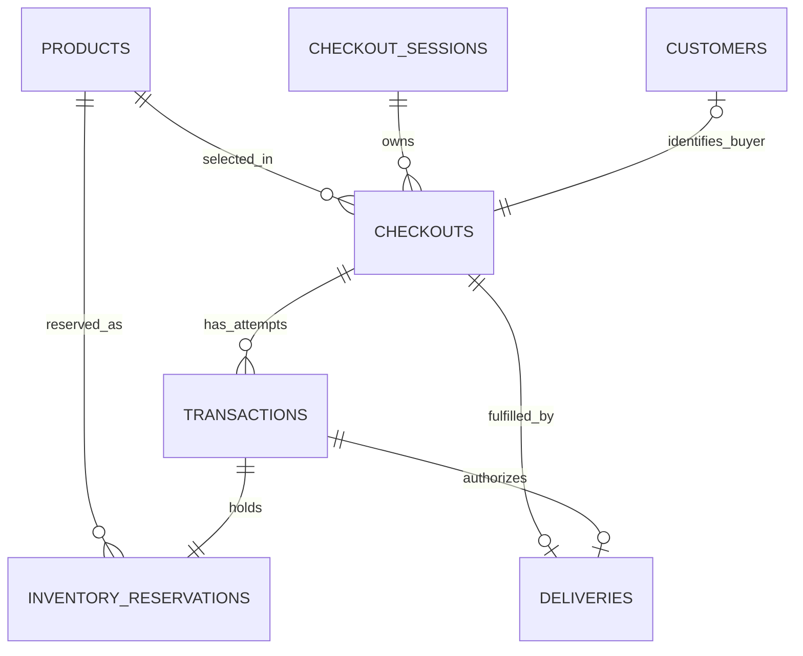

# Payment Checkout

Assessment de compra de un producto: catálogo y stock, comprador/entrega, resumen,
pago con tarjeta en sandbox y resultado con inventario actualizado. Orientado a
móvil y recuperable al refrescar. 

## Estado actual

| Implementado                                                    | Propuesto / pendiente                                               |
| --------------------------------------------------------------- | ------------------------------------------------------------------- |
| NestJS 11 + TypeScript, PostgreSQL 17 en Docker, TypeORM 1.1.3  | Modelo de negocio, migraciones, seed y endpoints de compra          |
| Variables validadas, Helmet, ValidationPipe y Swagger           | Sesión/CSRF, pagos sandbox, reservas, idempotencia y reconciliación |
| GET / devuelve Hello World!; pruebas unitarias y e2e de la base | SPA React, cobertura del negocio, Linux y despliegue AWS            |

Frontend acordado: React + TypeScript + Vite, Redux Toolkit/React Redux,
React Hook Form/Zod, CSS Modules y Flexbox/Grid, Jest/React Testing Library.
Backend conserva @nestjs/config, class-validator/class-transformer, Swagger,
Helmet y neverthrow. No hay aplicación desplegada ni URL pública disponible.

## Ejecutar localmente (Windows / PowerShell)

Requisitos: Node.js 24, npm, Git y Docker Desktop con contenedores Linux.
La base se verificó con Node 24.11.1 y npm 11.6.2. Desde la raíz:

```powershell
# Solo la primera vez; no sobrescribir un .env existente
Copy-Item .env.example .env
docker compose up -d db
docker compose ps
Set-Location backend
npm ci
npm run start:dev
```

Esperar a `db` healthy. API: <http://localhost:3000>, Swagger:
<http://localhost:3000/docs>, OpenAPI: <http://localhost:3000/docs-json>.
Son rutas locales actuales; los endpoints de negocio aún no aparecen en Swagger.
Ctrl+C detiene NestJS. PostgreSQL usa `127.0.0.1:5433` desde Windows y volumen
persistente; `docker compose stop db` lo detiene desde la raíz sin borrar datos.

| Variable obligatoria | Regla / ejemplo local               |
| -------------------- | ----------------------------------- |
| DB_HOST              | Texto no vacío; 127.0.0.1           |
| DB_PORT              | Entero 1..65535; 5433               |
| DB_NAME              | Texto no vacío; payment_checkout    |
| DB_USER              | Texto no vacío; checkout            |
| DB_PASSWORD          | Definir en .env; ejemplo solo local |
| PORT                 | Entero 1..65535; 3000               |

Nest busca .env del directorio de ejecución y después del padre; variables del
proceso tienen prioridad. Compose lee el .env raíz. No versionar secretos.
Cambiar .env no cambia credenciales de un volumen PostgreSQL ya inicializado.
Se conservan synchronize=false y migrationsRun=false; todavía no hay comandos
de migración ni seed. Linux no se ha verificado como runtime del backend.

## Pruebas y cobertura

Desde backend, con PostgreSQL healthy para e2e:

```powershell
npm run format:check
npm run lint:check
npm run build
npm test -- --runInBand
npm run test:e2e -- --runInBand
npm run test:cov -- --runInBand
```

Para arrancar compilado: `npm run build` y `npm run start:prod`. Los scripts
existen y la base se comprobó en Windows. Las e2e actuales solo leen PostgreSQL:
consulta SQL, Hello World, Helmet, Swagger y validación global. Las unitarias
cubren configuración. No equivalen a pruebas del negocio todavía no creado.

En esta revisión documental pasaron las 55 pruebas unitarias y las 6 e2e
existentes con PostgreSQL. No se añadieron pruebas ni se midió cobertura.

La prueba exige **más del 80 % en frontend y backend por separado**; meta >=85 %
en statements, branches, functions y lines. Cobertura de esta revisión documental:
no medida; frontend no existe. Al implementar, registrar comando/fecha/commit y
porcentajes reales de cada proyecto. No atribuir cobertura backend al frontend.
Escenarios previstos: dinero/overflow, estados, stock concurrente, doble clic,
idempotencia, aprobado/rechazado, timeout/sync, eventos repetidos, refresh e IDOR.

## API y modelo propuestos

[Contrato API](docs/api-contract.md): catálogo, sesión, checkout/resumen,
transacciones/pay/sync y webhook. Clientes/destino se capturan por checkout;
no necesitan CRUD públicos. Productos ficticios mediante seed idempotente.



[Modelo detallado](docs/data-model.md): compra distinta de intento; un intento
activo, importes y datos históricos congelados, stock/reservas y entrega solo al
aprobar. Montos en centavos calculados por servidor. Bloqueos e índices PostgreSQL
protegen concurrencia; clave/hash del intento evitan duplicación de cobro.

## Arquitectura y recorrido

[Flujo y decisiones](docs/checkout-flow.md): producto -> tarjeta/entrega -> resumen
-> resultado -> producto actualizado. Catálogo, Checkout, Payments y Fulfillment
en un monolito hexagonal: dominio puro, casos de uso con Result/ResultAsync de
neverthrow, puertos y adaptadores TypeORM/Wompi. Controllers sin lógica de negocio;
NestJS conecta implementaciones.

Se eliminan versiones/TTL de cotizaciones: crear intento compara el resumen
aceptado con el cálculo actual y lo congela. Stock se reserva atómicamente antes
del cobro. Timeout incierto conserva reserva y bloquea otro envío: webhook y sync
comparten finalización. Refresh recupera estado desde backend con sesión propia;
Redux persistido guarda como máximo IDs/paso, nunca tarjeta o tokens.

## AWS y limitaciones

Se mantiene la propuesta AWS: backend en ECS Fargate, PostgreSQL en RDS y SPA en
S3/CloudFront, mismo origen con /api para backend. No se cambia de proveedor ni
de arquitectura de despliegue; aún falta implementar y verificar Linux, HTTPS,
secretos inyectados, TLS/conectividad DB y coste. No hay URLs desplegadas.

Para este assessment no hay scheduler/leases: sync mientras la UI está abierta,
webhook y revisión manual. Si nadie vuelve y no llega evento, un pago incierto
puede retener stock hasta revisar; no se declara resuelto por quitar los jobs.
Recuperar sin ID remoto requiere verificar capacidades UAT; nunca reenviar por
un timeout o liberar por un not-found aislado. También quedan por validar
contratos/auth/firma/límites en UAT y confirmar tarifas ficticias propuestas.
Solo datos ficticios; política de retención y operación con datos reales quedan
fuera de este alcance. No hay triggers de inmutabilidad: se protege por casos de
uso/repositorios/tests, sin garantía frente a SQL privilegiado.
