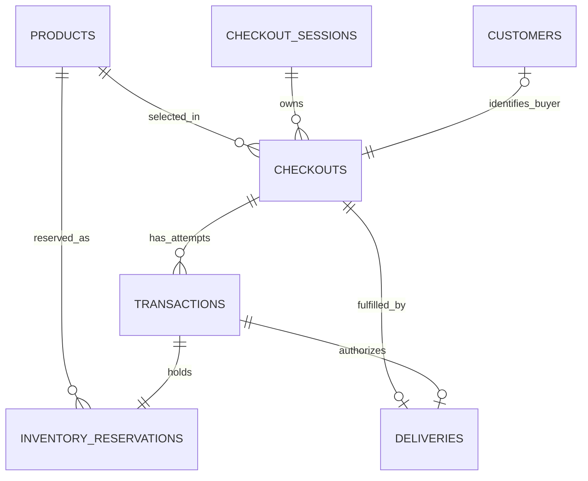

# Payment Checkout

Assessment de compra de un producto: catálogo y stock, comprador/entrega, resumen,
pago con tarjeta en sandbox y resultado con inventario actualizado. Orientado a
móvil y recuperable al refrescar.

## Estado actual

| Implementado                                                    | Propuesto / pendiente                                               |
| --------------------------------------------------------------- | ------------------------------------------------------------------- |
| NestJS 11 + TypeScript, PostgreSQL 17 en Docker, TypeORM 1.1.3  | Casos de uso y endpoints de compra                                  |
| Money COP y catálogo GET /api/v1/products y /:id                | Checkout, captura de comprador/destino y resumen                    |
| Entidades ORM, migración inicial y seed idempotente             | Repositorios de negocio, bloqueos y finalización atómica            |
| Variables validadas, Helmet, ValidationPipe y Swagger           | Sesión/CSRF, pagos sandbox, reservas, idempotencia y reconciliación |
| GET / devuelve Hello World!; pruebas unitarias y e2e de la base | SPA React, cobertura del negocio, Linux y despliegue AWS            |

Frontend acordado: React + TypeScript + Vite, Redux Toolkit/React Redux,
React Hook Form/Zod, CSS Modules y Flexbox/Grid, Jest/React Testing Library.
Backend conserva @nestjs/config, class-validator/class-transformer, Swagger,
Helmet y neverthrow. No hay aplicación desplegada ni URL pública disponible.

## Ejecutar localmente (Windows / PowerShell)

Requisitos: Node.js 24, npm, Git y Docker Desktop con contenedores Linux.
La base se verificó con Node 24.11.1 y npm 11.6.2. Desde la raíz:

```powershell
# Solo la primera vez; no sobrescribir un .env existente
Copy-Item .env.example .env
docker compose up -d db
docker compose ps
Set-Location backend
npm ci
npm run migration:run
npm run seed:products
npm run start:dev
```

Esperar a `db` healthy. API: <http://localhost:3000>, Swagger:
<http://localhost:3000/docs>, OpenAPI: <http://localhost:3000/docs-json>.
Swagger ya permite consultar el catálogo; checkout y pagos todavía no están implementados.
Ctrl+C detiene NestJS. PostgreSQL usa `127.0.0.1:5433` desde Windows y volumen
persistente; `docker compose stop db` lo detiene desde la raíz sin borrar datos.

| Variable obligatoria | Regla / ejemplo local               |
| -------------------- | ----------------------------------- |
| DB_HOST              | Texto no vacío; 127.0.0.1           |
| DB_PORT              | Entero 1..65535; 5433               |
| DB_NAME              | Texto no vacío; payment_checkout    |
| DB_USER              | Texto no vacío; checkout            |
| DB_PASSWORD          | Definir en .env; ejemplo solo local |
| PORT                 | Entero 1..65535; 3000               |

Nest busca .env del directorio de ejecución y después del padre; variables del
proceso tienen prioridad. Compose lee el .env raíz. No versionar secretos.
Cambiar .env no cambia credenciales de un volumen PostgreSQL ya inicializado.
Se conservan synchronize=false y migrationsRun=false: el arranque no crea tablas
ni ejecuta migraciones. CLI y seed reutilizan validación y precedencia de entorno,
incluyendo .env UTF-8 con BOM de Windows. Linux no se ha verificado como runtime
del backend; PostgreSQL sí se ejecuta en contenedor Linux.

## Probar catálogo en Swagger

Con la API arrancada, abrir <http://localhost:3000/docs> y desplegar **products**:

1. GET `/api/v1/products`: Try it out -> Execute. Devuelve todos los productos
   activos, incluidos los agotados, sin paginación. limit, cursor y filtros se
   rechazan con 400 INVALID_QUERY_PARAMS, no se ignoran.
2. GET `/api/v1/products/{id}`: usar `11111111-1111-4111-8111-111111111111`
   (auriculares) o `22222222-2222-4222-8222-222222222222` (parlante).
3. Un identificador `invalid-id` devuelve 400; el UUID
   `bbbbbbbb-bbbb-4bbb-8bbb-bbbbbbbbbbbb` devuelve 404. No requiere sesión.

Productos ficticios para sandbox, definidos para una tienda de tecnología.
Los diez productos y categorías son decisiones del proyecto, no requisitos
textuales del PDF. Datos locales al verificar:

| SKU     | Producto                       | Categoría         | Centavos COP | COP    | Disponible |
| ------- | ------------------------------ | ----------------- | ------------ | ------ | ---------- |
| AUD-001 | Auriculares inalámbricos Nova  | audio             | 12990000     | 129900 | 10         |
| AUD-002 | Parlante portátil Pulse        | audio             | 17990000     | 179900 | 5          |
| COM-001 | Teclado mecánico K68           | computacion       | 18990000     | 189900 | 12         |
| COM-002 | Mouse inalámbrico Ergo         | computacion       | 7990000      | 79900  | 18         |
| COM-003 | Cámara web Full HD Focus       | computacion       | 11990000     | 119900 | 10         |
| ACC-001 | Cargador USB-C de 65 W         | accesorios        | 9990000      | 99900  | 20         |
| ACC-002 | Hub USB-C de seis puertos      | accesorios        | 14990000     | 149900 | 14         |
| ALM-001 | SSD portátil de 1 TB           | almacenamiento    | 32990000     | 329900 | 8          |
| HOG-001 | Bombillo inteligente Wi-Fi RGB | hogar-inteligente | 4990000      | 49900  | 25         |
| HOG-002 | Enchufe inteligente Wi-Fi      | hogar-inteligente | 5990000      | 59900  | 16         |

La disponibilidad se calcula desde stock menos reservas HELD: excluye las
vencidas NOT_SENT y conserva las comprometidas IN_FLIGHT/SUBMITTED/UNKNOWN.
Es una consulta, no crea reservas ni descuenta inventario. Imagen y SKU también
se devuelven. Money solo representa/valida centavos enteros COP entre 0 y
2000000000; el precio del producto debe ser positivo. No hay tarifas ni resumen
implementados todavía.

## Migraciones y seed

Desde backend, contra la DB indicada por las variables de entorno:

```powershell
npm run migration:generate -- src/infrastructure/database/migrations/NombreDelCambio
npm run migration:run
npm run seed:products
npm run migration:revert
```

Generar compara las entidades con la base seleccionada; revisar el SQL antes de
versionarlo. Revertir deshace la última migración y puede eliminar columnas/datos: usar
una base descartable para comprobarlo. La inicial crea las siete tablas del modelo;
no aplica reglas de compra ni procesa pagos. AddProductCategory1795643379559 añade
category y transforma una sola vez los dos productos originales, conservando sus
UUID/stock. Si detecta presentación personalizada o colisión de SKU, aborta la
migración completa con CATALOG_TRANSITION_CONFLICT; no sobrescribir ni borrar para
resolverlo automáticamente. El seed inserta los diez por ID/SKU y nunca actualiza
existentes después de esa transición. Se conservan productos ajenos, reservas e
históricos. Revertir la migración de categoría no deshace precios/SKU de productos.

Las diez imageUrl de placehold.co fueron comprobadas por HTTP el 2026-11-25:
200, image/png, 800×600. Son **placeholders con texto**, no fotografías ni
representaciones físicas de los productos. Las imágenes reales quedan pendientes;
no se agregó generación ni subida de archivos.

## Pruebas y cobertura

Desde backend, con PostgreSQL healthy para integración y e2e:

```powershell
npm run format:check
npm run lint:check
npm run build
npm test -- --runInBand
npm run test:e2e -- --runInBand
npm run test:integration
npm run test:cov -- --runInBand
```

Para arrancar compilado: `npm run build` y `npm run start:prod`. Los scripts
existen y la base se comprobó en Windows. Las e2e comprueban HTTP, catálogo,
Hello World, Helmet, Swagger y validación global; el catálogo usa fixtures en
bases aisladas. Las unitarias cubren configuración, Money y casos de consulta.
No equivalen a pruebas del checkout todavía no implementado.

Verificado en Windows: 88 unitarias, 22 de integración y 22 e2e. Las pruebas
nuevas de catálogo usan bases aisladas; sus fixtures no alteran desarrollo.
La integración crea payment_checkout_test_<aleatorio> desde cero, migra, prueba
restricciones/seed, revierte/reaplica y elimina esa base. Requiere que DB_USER
pueda CREATE DATABASE en el servidor local; nunca limpia la base DB_NAME.
También se comprobaron los comandos CLI en otra base temporal, incluida
migration:generate con --check sin cambios. En este bloque se verificó la identidad
del PostgreSQL local de Docker. Están aplicadas InitialSchema1795632838292 y
AddProductCategory1795643379559. Seed repetido sin cambios, stock original y
reservas/históricos preservados. La transición de un original personalizado y su
rollback se probaron solo en base aislada.

La prueba exige **más del 80 % en frontend y backend por separado**; meta >=85 %
en statements, branches, functions y lines. Medición unitaria del 2026-11-25,
base ad2bf8ff + cambios Money/catálogo/categoría sin commit, con
`npm test -- --runInBand --coverage --coverageReporters=text`:

| Alcance                                             | Statements | Branches | Functions | Lines   |
| --------------------------------------------------- | ---------- | -------- | --------- | ------- |
| Backend global, todo src con exclusiones existentes | 16,31 %    | 30,08 %  | 24,24 %   | 16,15 % |

El >80 % global sigue **pendiente**. No se incluyen integración/e2e en esas
métricas; tampoco se cambiaron exclusiones. Money y los casos ListProducts y
GetProduct tienen 100 % en sus cuatro métricas. Frontend aún no existe y no
tiene cobertura; no se le atribuye la del backend.
Escenarios previstos: dinero/overflow, estados, stock concurrente, doble clic,
idempotencia, aprobado/rechazado, timeout/sync, eventos repetidos, refresh e IDOR.

## API propuesta y modelo persistido

[Contrato API](docs/api-contract.md) y [OpenAPI exportado](docs/openapi.json): catálogo, sesión, checkout/resumen,
transacciones/pay/sync y webhook. Clientes/destino se capturan por checkout;
no necesitan CRUD públicos. Productos ficticios mediante seed idempotente.



[Modelo detallado](docs/data-model.md): compra distinta de intento; un intento
activo, importes y datos históricos congelados, stock/reservas y entrega solo al
aprobar. Money valida los importes del catálogo sin framework. Los índices PostgreSQL
aportan restricciones de unicidad; los casos de uso que aplicarán bloqueos,
compararán hashes y coordinarán cobro/inventario/entrega siguen pendientes.

## Arquitectura y recorrido

[Flujo y decisiones](docs/checkout-flow.md): producto -> tarjeta/entrega -> resumen
-> resultado -> producto actualizado. Catálogo, Checkout, Payments y Fulfillment
en un monolito hexagonal: dominio puro, casos de uso con Result/ResultAsync de
neverthrow, puertos y adaptadores TypeORM/Wompi. Controllers sin lógica de negocio;
NestJS conecta implementaciones.

Para el checkout futuro, sin versiones/TTL de cotizaciones: crear intento compara el resumen
aceptado con el cálculo actual y lo congela. Stock se reserva atómicamente antes
del cobro. Timeout incierto conserva reserva y bloquea otro envío: webhook y sync
comparten finalización. Refresh recupera estado desde backend con sesión propia;
Redux persistido guarda como máximo IDs/paso, nunca tarjeta o tokens.

## AWS y limitaciones

Se mantiene la propuesta AWS: backend en ECS Fargate, PostgreSQL en RDS y SPA en
S3/CloudFront, mismo origen con /api para backend. No se cambia de proveedor ni
de arquitectura de despliegue; aún falta implementar y verificar Linux, HTTPS,
secretos inyectados, TLS/conectividad DB y coste. No hay URLs desplegadas.

Para este assessment no hay scheduler/leases: sync mientras la UI está abierta,
webhook y revisión manual. Si nadie vuelve y no llega evento, un pago incierto
puede retener stock hasta revisar; no se declara resuelto por quitar los jobs.
Recuperar sin ID remoto requiere verificar capacidades UAT; nunca reenviar por
un timeout o liberar por un not-found aislado. También quedan por validar
contratos/auth/firma/límites en UAT y confirmar tarifas ficticias propuestas.
Solo datos ficticios; política de retención y operación con datos reales quedan
fuera de este alcance. No hay triggers de inmutabilidad: sus garantías mediante
futuros casos de uso/repositorios aún están pendientes, sin protección frente a
SQL privilegiado.
