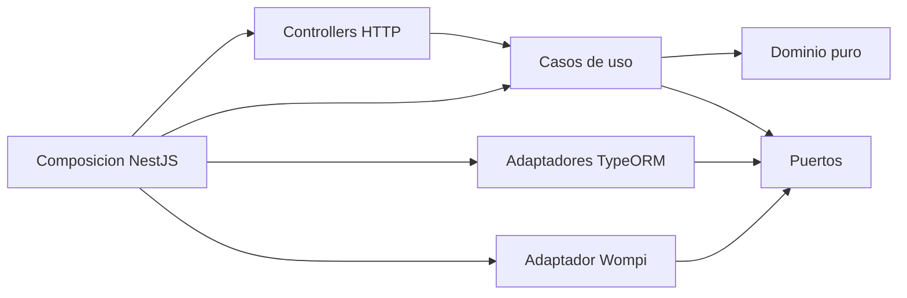

# Recorrido y reglas de checkout

**Backend de catálogo, sesión, borrador/resumen, intentos/reservas y pagos implementado; frontend con tienda, carrito de compras independientes, historial y checkout implementado. Webhook pendiente.** Esta revisión no repite pagos reales desde navegador.
Ver [modelo](data-model.md), [contrato HTTP](api-contract.md) y [estado actual](../README.md).

## Cinco pantallas

| Pantalla             | Comportamiento y caso de uso                                                                                                                                                                                                                                                                       |
| -------------------- | -------------------------------------------------------------------------------------------------------------------------------------------------------------------------------------------------------------------------------------------------------------------------------------------------- |
| 1. Producto          | ListProducts/GetProduct muestran precio y disponibilidad del seed. Crear sesión y CreateCheckout al continuar; no reservar aún.                                                                                                                                                                    |
| 2. Tarjeta y entrega | UpdateCheckout guarda comprador/destino. Modal de tarjeta y validación cliente; tarjeta solo en memoria.                                                                                                                                                                                           |
| 3. Resumen           | GetSummary calcula producto × cantidad + tarifa base + entrega sin tokenizar. Tras confirmar, el navegador cifra con la clave pública entregada por la configuración y tokeniza directamente con Wompi; CreateTransaction congela el resumen y reserva antes de StartPayment. Resumen en backdrop. |
| 4. Resultado         | GetTransaction/SyncPayment muestran pendiente, aprobado o rechazado. Nunca interpretar una redirección del navegador como aprobación.                                                                                                                                                              |
| 5. Producto          | Consultar de nuevo disponibilidad y permitir otra compra. Una compra pagada no se reutiliza para cobrar.                                                                                                                                                                                           |

Tarifas ficticias implementadas en el resumen: base 50000 y entrega 100000 centavos por compra,
COP y una cuota. Ejemplo: 2 × 12990000 + 50000 + 100000 = 26130000. Los límites
completos del proveedor deben verificarse antes de ampliar el uso del assessment.

## Arquitectura pequeña, con límites reales

Se conserva el monolito NestJS y cuatro responsabilidades: Catalog posee
productos/reservas, Checkout coordina compradores/compras/intentos, Payments
encapsula Wompi y Fulfillment crea la entrega. No nuevos microservicios ni bus.



Las flechas muestran dependencias entre capas. NestJS conecta los adaptadores
a los puertos. Payments utiliza contratos del intento de Checkout; dominio y
aplicación no dependen de NestJS, TypeORM o HTTP. No hay webhook implementado.

La estructura existente usa `domain/`, `application/` e `infrastructure/`.
Dominio contiene entidades/reglas puras, sin NestJS, HTTP o TypeORM. Aplicación
contiene casos de uso y puertos; adaptadores contienen controllers/DTOs,
entidades ORM y cliente del proveedor. Dominio y ORM son modelos separados con
mappers. Money puro se comparte entre catálogo y compra, sin crear un shared
de servicios globales.

Implementados ProductRepository, SessionStore, SessionTokens y CheckoutStore.
CheckoutStore encapsula la transacción y el lock del borrador; no expone SQL.
Para crear intentos se usa TransactionStore.run y para pagos PaymentStore.run,
con contextos concretos de locks/escrituras;
no exponen EntityManager. PaymentGateway ya está implementado; no se introdujo
una UoW genérica adicional ni un repositorio CRUD universal.
Controllers validan forma/autorizan y traducen resultados, no calculan ni cobran.

ROP implementado con Result y ResultAsync de neverthrow en casos de uso y puertos.

Usar Result para reglas puras y ResultAsync para I/O. Capturar excepciones de
librerías como unknown en adaptadores, sin any, unwrap ni excepciones genéricas
para flujo normal. Un rechazo es resultado de negocio; fallo técnico confirmado
sin cobro permite otro intento; timeout ambiguo mantiene PENDING/UNKNOWN.

## Estados y transacciones SQL

Compra: DRAFT -> PAYMENT_PENDING -> PAID. Un resultado negativo o vencimiento
sin envío vuelve a DRAFT; PAID es terminal. No añadir estados de logística real.

Intento: PENDING -> APPROVED/DECLINED/VOIDED/ERROR/EXPIRED. Solo EXPIRED si no se
envió. ERROR requiere resultado definitivo del proveedor o evidencia inequívoca
de que no creó cobro. Un error de red no cumple esa condición.

| Estado de envío | Significado                                | Acción segura                                         |
| --------------- | ------------------------------------------ | ----------------------------------------------------- |
| NOT_SENT        | Todavía no se intentó enviar               | Puede iniciarse antes de vencer la reserva            |
| IN_FLIGHT       | Claim SQL confirmado antes del HTTP        | Ningún segundo POST al proveedor                      |
| SUBMITTED       | Proveedor devolvió ID                      | Consultar por ese ID hasta resultado final            |
| UNKNOWN         | Pudo enviarse pero no hay respuesta fiable | Reconciliar; mantener reserva y bloquear otro intento |
| NOT_CREATED     | Proveedor garantizó que no creó cobro      | Intento ERROR; permitir nuevo intento                 |

1. **Crear intento (implementado):** bajo lock de checkout y producto, comparar el resumen que
   aceptó el usuario con el cálculo actual del servidor. Si cambió algún importe
   o cantidad, SUMMARY_CHANGED sin reservar; revisar de nuevo. Si coincide y hay
   stock, insertar intento PENDING/NOT_SENT y reserva HELD, cambiar compra a
   PAYMENT_PENDING, commit. Nunca aceptar importes del cliente como autoridad.
2. **Iniciar cobro (implementado):** lock del mismo checkout/intento/producto; validar reserva,
   token/aceptaciones y hacer claim NOT_SENT -> IN_FLIGHT, commit. Después llamar
   a Wompi con la referencia y monto congelados, sin transacción SQL abierta.
3. **Guardar respuesta (implementado):** persistir ID/resultado o UNKNOWN. Una caída después del
   claim es incierta aunque el proceso pudiera no haber enviado bytes. Si falla
   guardar el ID, IN_FLIGHT sigue bloqueando otro envío. El ID/SUBMITTED se confirma
   antes de los efectos financieros; si falla crear entrega, sync puede reconsultar
   por ese ID y reintentar la finalización sin otro cobro.
4. **Finalizar (implementado):** un único FinalizePayment bloquea esas filas, valida ID,
   referencia, importe, moneda y ambiente. APPROVED: decrementar stock, confirmar
   reserva, crear entrega READY y compra PAID en un commit. Negativo: liberar y
   volver a DRAFT. Resultado final repetido es no-op; contradictorio es conflicto
   para revisión, nunca otro descuento. Una anulación posterior a una aprobación
   no inicia automáticamente reposición/reembolso, fuera de este assessment.

## Idempotencia y concurrencia sin tablas genéricas

POST transactions exige Idempotency-Key UUID. Guardarla en transactions con
UNIQUE(checkout_id, idempotency_key) y hash del checkout/resumen aceptado. Misma clave y
misma entrada devuelve el mismo intento antes de comprobar el estado actual;
misma clave con otra entrada ->409. Índice parcial único impide dos PENDING por
compra y otro impide dos APPROVED. Un rechazo permite nueva clave/nuevo intento,
nunca sobrescribir el anterior.

POST pay es idempotente por transactionId: guardar hash de token, cuota y
aceptaciones normalizados junto con el claim. Mismo hash recupera estado; otro
hash ->409, sin enviar de nuevo. El hash SHA-256 incluye tokens opacos de alta
entropía; no almacenar su texto. Nueva clave o doble clic no elude el claim.
Después de refrescar y perder el token, usar GET/sync en vez de repetir pay.
Las restricciones únicas y locks son la garantía entre procesos, no mutex en RAM.
No es una promesa de exactly-once de la API remota.

## Abandono y recuperación sin jobs

Reserva no enviada: 10 minutos. Disponible excluye automáticamente HELD vencida
con NOT_SENT; no hace falta barrido para que otro comprador pueda reservar.
Al iniciar o crear otro intento para esa compra, bajo los locks se marca el viejo
EXPIRED/RELEASED y se vuelve a DRAFT. Un intento que ya se envió no vence por ese
reloj. La expiración se confirma antes de devolver el error al cliente, no se
revierte accidentalmente por lanzar una excepción dentro de la UoW.

No hay jobs, leases ni scheduler durable en el assessment. POST sync usa FinalizePayment; el webhook pendiente reutilizará el mismo caso. Sync puede consultar simultáneamente: son lecturas externas
y la aplicación del resultado se serializa en SQL. El frontend limita el polling
a ocho consultas visibles, con espera progresiva de 5 a 30 segundos y cancelación al salir,
y GET recupera el estado local. GET no llama al proveedor ni cambia datos.
IN_FLIGHT de más de 30 segundos se trata como UNKNOWN al sincronizar; nunca
habilita reenvío por tiempo.

Con ID remoto se consulta al proveedor. Sin ID se debe verificar en UAT si hay
búsqueda por referencia o garantía remota equivalente; no se inventa una ruta.
Sin esa capacidad, mantener bloqueo/reserva y revisar en la cuenta del proveedor
hasta obtener evidencia definitiva. No existe webhook que recupere el ID. Un not-found aislado o timeout no autoriza liberar/repetir.

**Limitación explícita:** si se cierra el navegador, no hay
reconciliación automática en segundo plano. Continúa al volver/sync o por revisión
manual. Mientras tanto stock incierto permanece reservado. Un scheduler solo se
añadiría en otra tarea si se requiere recuperación independiente del navegador.

Cookie guest HttpOnly, SameSite=Lax, Secure en HTTPS, digest en DB y vigencia de
24 h sin renovación; desarrollo local permite HTTP. Implementado con token
aleatorio de 256 bits, SHA-256 en DB y CSRF HMAC-SHA256 con CSRF_SECRET estable. Autorización por sesión propietaria en cada
compra/intento. Origin permitido + token CSRF vinculado a la sesión para
escrituras; emitir/recuperar CSRF al iniciar sesión. Mismo origen en AWS; en Vite
local usar el proxy Vite /api, conservando Origin y cookie del mismo origen.

localStorage conserva nodo.checkout.v1 con checkoutId/transactionId/paso y clave
de idempotencia, y nodo.cart.v1 con una lista de productId/quantity;
Redux no se persiste. En el navegador, comprador y entrega viven solo en memoria
del formulario y, igual que tarjeta y tokens, nunca se guardan en Redux, Local
Storage o Session Storage. El backend sí persiste comprador y destino en
PostgreSQL para restaurar el checkout, siempre autorizado por la sesión invitada;
al crear el intento, los snapshots financieros quedan asociados a la transacción.
Tras refresh, recuperar sesión/CSRF y consultar backend. Si cookie vence, no
recuperar PII por UUID; resolver pagos pendientes mediante proveedor/revisión
aunque el cliente ya no pueda acceder. No hay cuentas ni recuperación por email
en este alcance.

«Mis compras» consulta los intentos de la sesión invitada actual, ordenados del
más reciente al más antiguo, y permite abrir el detalle con las lecturas existentes.
La consulta no llama al proveedor ni ejecuta pay/sync. Checkout, intento, importes
históricos, reserva y entrega permanecen en PostgreSQL al recargar, cerrar la
pestaña, reiniciar el backend o limpiar localStorage. Perder o vencer la cookie no
elimina esos registros: elimina el acceso del navegador, porque no hay cuentas ni
recuperación por correo en este assessment.

## Qué se simplificó y qué lo reemplaza

| Antes                                        | Assessment de dos días                                                  | Garantía / límite                                                                                         |
| -------------------------------------------- | ----------------------------------------------------------------------- | --------------------------------------------------------------------------------------------------------- |
| ETag/If-Match obligatorios                   | Lock SQL al editar e iniciar                                            | Sin edición de intento activo; DRAFT usa última escritura, UI serializa guardados y espera antes de pagar |
| Catálogo paginado                            | GET devuelve seed pequeño completo                                      | No sirve como contrato para catálogo masivo                                                               |
| Cotizaciones persistidas/versionadas/con TTL | Resumen calculado al leer y comparado al crear intento                  | Cambios requieren nueva aceptación; snapshot fija importes desde PENDING                                  |
| Tablas genéricas de idempotencia/eventos     | Clave y hashes en intento; finalización idempotente                     | Sin bitácora completa de cada evento; logs mínimos de ID/estado/conflicto                                 |
| Triggers y snapshots financieros duplicados  | Campos históricos únicos, repositorios sin operación de edición y tests | Protege escrituras de la aplicación, no SQL privilegiado                                                  |
| Contadores reservados y jobs de expiración   | Suma de reservas activas bajo lock de producto                          | Consulta suficiente para catálogo pequeño; pago incierto sigue retenido                                   |
| Jobs con leases                              | Sync del frontend y revisión manual; webhook pendiente                  | No recuperación automática cuando el navegador está cerrado                                               |
| Procedimientos de retención/anonimización    | Solo datos ficticios y secretos fuera del repo                          | Política de producción pendiente, no resuelta                                                             |

## Verificación del recorrido

Unitarias Jest comprueban importes, decisiones de aplicación, HTTP y adaptadores
con dobles. PostgreSQL aislado comprueba restricciones, última unidad concurrente,
claims, idempotencia y rollback efectivo. E2E comprueba autorización por sesión,
contratos y pagos con proveedor simulado. Los resultados actuales están en
[pruebas y cobertura](../README.md#pruebas-y-cobertura). Las unitarias no prueban
concurrencia real ni sustituyen una verificación UAT desde navegador.

Los ensayos UAT anteriores confirmaron un aprobado y un rechazo independiente;
un intento previo sin ID quedó incierto y no se reconstruyó. No se ha repetido
ningún pago durante la revisión documental. Webhooks y recuperación remota sin ID
siguen pendientes.

## Carrito y continuidad del navegador

El carrito mantiene varias líneas como cola de compras independientes. Cada línea
conserva productId y quantity; no hay pago conjunto. Tras aprobar, se elimina solo
la línea comprada, se consultan catálogo e historial y se vuelve al inicio después
de mostrar el resultado. El stock definitivo siempre procede del servidor.
La ficha breve del producto se abre dentro del checkout sin reiniciar el proceso.

El inicio no abre automáticamente el modal. Un borrador ofrece continuar o
descartar solo su puntero local. Un intento enviado o incierto mantiene el bloqueo.
Si la cookie actual no permite recuperar un puntero antiguo, se informa que la
compra permanece registrada y se exige una acción explícita para iniciar otra;
el carrito se conserva. Consultar historial/detalle no ejecuta pay ni sync.

Para revisar privacidad en Chrome:

- Application → Local Storage: nodo.cart.v1 y nodo.checkout.v1, con los campos
  limitados descritos arriba. No debe haber tarjeta, CVC, token ni dirección.
- Application → Session Storage: la aplicación no escribe datos allí.
- Application → Cookies: checkout_session es HttpOnly; no copiar su valor.
- Redux DevTools está desactivado; el store y sus acciones solo reciben vistas
  públicas, carrito y estado de interfaz, no comprador, destino ni tarjeta.
- Network: nuestras solicitudes van a /api; el POST cifrado de tokenización va
  directamente al proveedor. No exportar HAR con cookies, tokens o datos personales.

## Observabilidad local

Iniciar PostgreSQL, API y frontend siguiendo [ejecución local](../README.md#ejecución-local).
La terminal de Nest muestra eventos JSON permitidos, como transaction.created,
reservation.held, payment.claimed, provider.transaction.saved, payment.unknown,
payment.finalized.approved/declined, inventory.confirmed y delivery.created.
Los cambios persistidos se registran después del commit; nunca se imprimen cuerpos,
tarjeta, tokens, cookies, claves o datos personales. El ID remoto se correlaciona
mediante fingerprint abreviado, no por su valor completo.

Para una compra ficticia ya creada, copiar el ID local del intento desde la
respuesta de nuestra API y ejecutar desde backend:

```powershell
npm run inspect:transaction -- <transactionId>
```

El inspector valida UUID, usa parámetros y una transacción READ ONLY, muestra
estados/importes/timestamps, reserva, stock y entrega; presenta centavos enteros y
pesos COP. No ejecuta migración ni seed. Devuelve error para ID inválido, inexistente
o fallo de conexión. GET /api/v1/transactions/:id consulta solo PostgreSQL con la
cookie propietaria. POST sync se utiliza para reconciliar un intento ya enviado;
no es una acción de cobro ni una recuperación por UUID sin autorización.

## Pruebas PostgreSQL aisladas

Integración crea bases payment_checkout_test_* y las elimina en finally.
Requiere PostgreSQL disponible y un rol de pruebas con CREATEDB. Ejecutar desde backend:

```powershell
npm run test:integration
```

Las e2e de catálogo y checkout también crean su base. app.e2e-spec.ts utiliza
DB_NAME del proceso, por lo que las e2e completas requieren una base temporal
externa. Este procedimiento PowerShell usa el entorno existente sin imprimir
credenciales, ejecuta el script oficial sin filtros y elimina solo la base creada:

```powershell
@'
const { loadDatabaseEnvironment } = require('./src/infrastructure/database/load-environment');
const { Client } = require('pg');
const { randomBytes } = require('node:crypto');
const { spawnSync } = require('node:child_process');
(async () => {
  const e = loadDatabaseEnvironment();
  const name = 'payment_checkout_test_' + randomBytes(8).toString('hex');
  if (!/^payment_checkout_test_[0-9a-f]{16}$/.test(name) || name === e.DB_NAME)
    throw new Error('Unsafe test database');
  const admin = new Client({ host: e.DB_HOST, port: e.DB_PORT,
    user: e.DB_USER, password: e.DB_PASSWORD, database: 'postgres' });
  let created = false;
  try {
    await admin.connect();
    await admin.query('CREATE DATABASE "' + name + '"');
    created = true;
    const run = spawnSync(process.env.ComSpec || 'cmd.exe',
      ['/d', '/s', '/c', 'npm run test:e2e -- --runInBand'],
      { env: { ...process.env, DB_NAME: name }, stdio: 'inherit' });
    process.exitCode = run.status === 0 ? 0 : 1;
  } finally {
    try {
      if (created) await admin.query('DROP DATABASE "' + name + '"');
    } finally { await admin.end(); }
  }
})().catch(() => { console.error('E2E execution or cleanup failed'); process.exitCode = 1; });
'@ | node -r ts-node/register
```

No usa la base de desarrollo. Los proveedores de las pruebas financieras están
simulados; las suites no crean pagos reales. Este procedimiento se verificó en
Windows; no se atribuye a Linux/AWS. La cobertura unitaria se mide por separado.

## Referencias de presentación

Fotos y banner locales se relacionan por SKU, sin duplicar precios ni existencias.
El texto decorativo del banner no representa un descuento aplicado.
Inter se aloja localmente con [SIL Open Font License](../frontend/public/fonts/OFL.txt).
Las composiciones de 21st se usaron como referencia, sin copiar su código:
[Commerce Hero](https://21st.dev/@bankkroll/components/commerce-hero),
[categorías](https://21st.dev/@ziegfiroyt/components/ecommerce4),
[listado](https://21st.dev/@clevision/components/shadcn-studio-product-list-01) y
[checkout](https://21st.dev/@preetsuthar17/components/checkout-block).
No se incorporaron Next.js, Tailwind ni shadcn.
