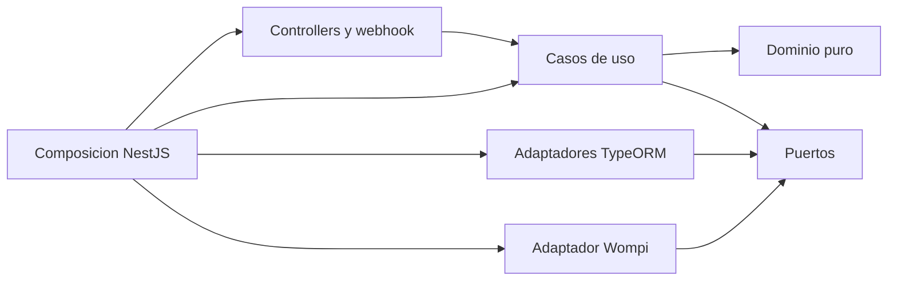

# Recorrido y reglas de checkout

**Backend de catálogo, sesión, borrador/resumen y creación/consulta de intentos con reserva implementados; configuración/pay/sync/finalización sandbox implementados; frontend con inicio, detalle, carrito y checkout implementado, recorrido de pago en navegador pendiente; webhook pendiente.**
Ver [modelo](data-model.md), [contrato HTTP](api-contract.md) y [estado actual](../README.md).

## Cinco pantallas

| Pantalla             | Comportamiento y caso de uso                                                                                                                                                                                                                                                                       |
| -------------------- | -------------------------------------------------------------------------------------------------------------------------------------------------------------------------------------------------------------------------------------------------------------------------------------------------- |
| 1. Producto          | ListProducts/GetProduct muestran precio y disponibilidad del seed. Crear sesión y CreateCheckout al continuar; no reservar aún.                                                                                                                                                                    |
| 2. Tarjeta y entrega | UpdateCheckout guarda comprador/destino. Modal de tarjeta y validación cliente; tarjeta solo en memoria.                                                                                                                                                                                           |
| 3. Resumen           | GetSummary calcula producto × cantidad + tarifa base + entrega sin tokenizar. Tras confirmar, el navegador cifra con la clave pública entregada por la configuración y tokeniza directamente con Wompi; CreateTransaction congela el resumen y reserva antes de StartPayment. Resumen en backdrop. |
| 4. Resultado         | GetTransaction/SyncPayment muestran pendiente, aprobado o rechazado. Nunca interpretar una redirección del navegador como aprobación.                                                                                                                                                              |
| 5. Producto          | Consultar de nuevo disponibilidad y permitir otra compra. Una compra pagada no se reutiliza para cobrar.                                                                                                                                                                                           |

Tarifas ficticias implementadas en el resumen: base 50000 y entrega 100000 centavos por compra,
COP y una cuota. Ejemplo: 2 × 12990000 + 50000 + 100000 = 26130000. Confirmar estos
valores y los límites del proveedor antes de implementar la integración.

## Arquitectura pequeña, con límites reales

Se conserva el monolito NestJS y cuatro responsabilidades: Catalog posee
productos/reservas, Checkout coordina compradores/compras/intentos, Payments
encapsula Wompi y Fulfillment crea la entrega. No nuevos microservicios ni bus.



Las flechas son dependencias de código. Checkout consume contratos de Catalog,
Payments y Fulfillment; estos no importan Checkout. El webhook es una entrada
de Checkout que utiliza el verificador de Payments. NestJS conecta dependencias.

La estructura existente usa `domain/`, `application/` e `infrastructure/`.
Dominio contiene entidades/reglas puras, sin NestJS, HTTP o TypeORM. Aplicación
contiene casos de uso y puertos; adaptadores contienen controllers/DTOs,
entidades ORM y cliente del proveedor. Dominio y ORM son modelos separados con
mappers. Money puro se comparte entre catálogo y compra, sin crear un shared
de servicios globales.

Implementados ProductRepository, SessionStore, SessionTokens y CheckoutStore.
CheckoutStore encapsula la transacción y el lock del borrador; no expone SQL.
Para crear intentos se usa TransactionStore.run y para pagos PaymentStore.run,
con contextos concretos de locks/escrituras;
no exponen EntityManager. PaymentGateway ya está implementado; no se introdujo
una UoW genérica adicional ni un repositorio CRUD universal.
Controllers validan forma/autorizan y traducen resultados, no calculan ni cobran.

ROP con neverthrow, ejemplo de firmas (propuestas, no código implementado):

```typescript
type CreateAttemptError =
  | { kind: "SummaryChanged" }
  | { kind: "InsufficientStock" }
  | { kind: "CheckoutLocked" }
  | { kind: "IdempotencyConflict" }
  | { kind: "PersistenceUnavailable" };

interface CreateTransaction {
  execute(
    input: CreateAttemptInput,
  ): ResultAsync<AttemptView, CreateAttemptError>;
}
// Dentro de la UoW: cargar compra autorizada -> comprobar resumen
// -> reservar y crear intento. andThen encadena pasos que pueden fallar;
// map transforma el éxito en AttemptView, mapErr traduce errores del adaptador.
```

Usar Result para reglas puras y ResultAsync para I/O. Capturar excepciones de
librerías como unknown en adaptadores, sin any, unwrap ni excepciones genéricas
para flujo normal. Un rechazo es resultado de negocio; fallo técnico confirmado
sin cobro permite otro intento; timeout ambiguo mantiene PENDING/UNKNOWN.

## Estados y transacciones SQL

Compra: DRAFT -> PAYMENT_PENDING -> PAID. Un resultado negativo o vencimiento
sin envío vuelve a DRAFT; PAID es terminal. No añadir estados de logística real.

Intento: PENDING -> APPROVED/DECLINED/VOIDED/ERROR/EXPIRED. Solo EXPIRED si no se
envió. ERROR requiere resultado definitivo del proveedor o evidencia inequívoca
de que no creó cobro. Un error de red no cumple esa condición.

| Estado de envío | Significado                                | Acción segura                                         |
| --------------- | ------------------------------------------ | ----------------------------------------------------- |
| NOT_SENT        | Todavía no se intentó enviar               | Puede iniciarse antes de vencer la reserva            |
| IN_FLIGHT       | Claim SQL confirmado antes del HTTP        | Ningún segundo POST al proveedor                      |
| SUBMITTED       | Proveedor devolvió ID                      | Consultar por ese ID hasta resultado final            |
| UNKNOWN         | Pudo enviarse pero no hay respuesta fiable | Reconciliar; mantener reserva y bloquear otro intento |
| NOT_CREATED     | Proveedor garantizó que no creó cobro      | Intento ERROR; permitir nuevo intento                 |

1. **Crear intento (implementado):** bajo lock de checkout y producto, comparar el resumen que
   aceptó el usuario con el cálculo actual del servidor. Si cambió algún importe
   o cantidad, SUMMARY_CHANGED sin reservar; revisar de nuevo. Si coincide y hay
   stock, insertar intento PENDING/NOT_SENT y reserva HELD, cambiar compra a
   PAYMENT_PENDING, commit. Nunca aceptar importes del cliente como autoridad.
2. **Iniciar cobro (implementado):** lock del mismo checkout/intento/producto; validar reserva,
   token/aceptaciones y hacer claim NOT_SENT -> IN_FLIGHT, commit. Después llamar
   a Wompi con la referencia y monto congelados, sin transacción SQL abierta.
3. **Guardar respuesta (implementado):** persistir ID/resultado o UNKNOWN. Una caída después del
   claim es incierta aunque el proceso pudiera no haber enviado bytes. Si falla
   guardar el ID, IN_FLIGHT sigue bloqueando otro envío. El ID/SUBMITTED se confirma
   antes de los efectos financieros; si falla crear entrega, sync puede reconsultar
   por ese ID y reintentar la finalización sin otro cobro.
4. **Finalizar (implementado):** un único FinalizePayment bloquea esas filas, valida ID,
   referencia, importe, moneda y ambiente. APPROVED: decrementar stock, confirmar
   reserva, crear entrega READY y compra PAID en un commit. Negativo: liberar y
   volver a DRAFT. Resultado final repetido es no-op; contradictorio es conflicto
   para revisión, nunca otro descuento. Una anulación posterior a una aprobación
   no inicia automáticamente reposición/reembolso, fuera de este assessment.

## Idempotencia y concurrencia sin tablas genéricas

POST transactions exige Idempotency-Key UUID. Guardarla en transactions con
UNIQUE(checkout_id, idempotency_key) y hash del checkout/resumen aceptado. Misma clave y
misma entrada devuelve el mismo intento antes de comprobar el estado actual;
misma clave con otra entrada ->409. Índice parcial único impide dos PENDING por
compra y otro impide dos APPROVED. Un rechazo permite nueva clave/nuevo intento,
nunca sobrescribir el anterior.

POST pay es idempotente por transactionId: guardar hash de token, cuota y
aceptaciones normalizados junto con el claim. Mismo hash recupera estado; otro
hash ->409, sin enviar de nuevo. El hash SHA-256 incluye tokens opacos de alta
entropía; no almacenar su texto. Nueva clave o doble clic no elude el claim.
Después de refrescar y perder el token, usar GET/sync en vez de repetir pay.
Las restricciones únicas y locks son la garantía entre procesos, no mutex en RAM.
No es una promesa de exactly-once de la API remota.

## Abandono y recuperación sin jobs

Reserva no enviada: 10 minutos. Disponible excluye automáticamente HELD vencida
con NOT_SENT; no hace falta barrido para que otro comprador pueda reservar.
Al iniciar o crear otro intento para esa compra, bajo los locks se marca el viejo
EXPIRED/RELEASED y se vuelve a DRAFT. Un intento que ya se envió no vence por ese
reloj. La expiración se confirma antes de devolver el error al cliente, no se
revierte accidentalmente por lanzar una excepción dentro de la UoW.

No hay jobs, leases ni scheduler durable en el assessment. POST sync usa FinalizePayment; el webhook pendiente reutilizará el mismo caso. Sync puede consultar simultáneamente: son lecturas externas
y la aplicación del resultado se serializa en SQL. El frontend solicita sync
cada 5 segundos mientras está pendiente y visible, con backoff ante errores,
y GET recupera el estado local. GET no llama al proveedor ni cambia datos.
IN_FLIGHT de más de 30 segundos se trata como UNKNOWN al sincronizar; nunca
habilita reenvío por tiempo.

Con ID remoto se consulta al proveedor. Sin ID se debe verificar en UAT si hay
búsqueda por referencia o garantía remota equivalente; no se inventa una ruta.
Sin esa capacidad, mantener bloqueo/reserva y revisar en la cuenta del proveedor
hasta obtener evidencia definitiva. Webhook puede recuperar el ID, pero no se
presupone su llegada. Un not-found aislado o timeout no autoriza liberar/repetir.

**Limitación explícita:** si se cierra el navegador y no llega webhook, no hay
reconciliación automática en segundo plano. Continúa al volver/sync o por revisión
manual. Mientras tanto stock incierto permanece reservado. Un scheduler solo se
añadiría en otra tarea si se requiere recuperación independiente del navegador.

Cookie guest HttpOnly, SameSite=Lax, Secure en HTTPS, digest en DB y vigencia de
24 h sin renovación; desarrollo local permite HTTP. Implementado con token
aleatorio de 256 bits, SHA-256 en DB y CSRF HMAC-SHA256 con CSRF_SECRET estable. Autorización por sesión propietaria en cada
compra/intento. Origin permitido + token CSRF vinculado a la sesión para
escrituras; emitir/recuperar CSRF al iniciar sesión. Mismo origen en AWS; en Vite
local usar el proxy Vite /api, conservando Origin y cookie del mismo origen.

localStorage conserva solo checkoutId/transactionId/paso y clave de idempotencia;
Redux no se persiste. En el navegador, comprador y entrega viven solo en memoria
del formulario y, igual que tarjeta y tokens, nunca se guardan en Redux, Local
Storage o Session Storage. El backend sí persiste comprador y destino en
PostgreSQL para restaurar el checkout, siempre autorizado por la sesión invitada;
al crear el intento, los snapshots financieros quedan asociados a la transacción.
Tras refresh, recuperar sesión/CSRF y consultar backend. Si cookie vence, no
recuperar PII por UUID; resolver pagos pendientes mediante proveedor/revisión
aunque el cliente ya no pueda acceder. No hay cuentas ni recuperación por email
en este alcance.

«Mis compras» consulta los intentos de la sesión invitada actual, ordenados del
más reciente al más antiguo, y permite abrir el detalle con las lecturas existentes.
La consulta no llama al proveedor ni ejecuta pay/sync. Checkout, intento, importes
históricos, reserva y entrega permanecen en PostgreSQL al recargar, cerrar la
pestaña, reiniciar el backend o limpiar localStorage. Perder o vencer la cookie no
elimina esos registros: elimina el acceso del navegador, porque no hay cuentas ni
recuperación por correo en este assessment.

## Qué se simplificó y qué lo reemplaza

| Antes                                        | Assessment de dos días                                                  | Garantía / límite                                                                                         |
| -------------------------------------------- | ----------------------------------------------------------------------- | --------------------------------------------------------------------------------------------------------- |
| ETag/If-Match obligatorios                   | Lock SQL al editar e iniciar                                            | Sin edición de intento activo; DRAFT usa última escritura, UI serializa guardados y espera antes de pagar |
| Catálogo paginado                            | GET devuelve seed pequeño completo                                      | No sirve como contrato para catálogo masivo                                                               |
| Cotizaciones persistidas/versionadas/con TTL | Resumen calculado al leer y comparado al crear intento                  | Cambios requieren nueva aceptación; snapshot fija importes desde PENDING                                  |
| Tablas genéricas de idempotencia/eventos     | Clave y hashes en intento; finalización idempotente                     | Sin bitácora completa de cada evento; logs mínimos de ID/estado/conflicto                                 |
| Triggers y snapshots financieros duplicados  | Campos históricos únicos, repositorios sin operación de edición y tests | Protege escrituras de la aplicación, no SQL privilegiado                                                  |
| Contadores reservados y jobs de expiración   | Suma de reservas activas bajo lock de producto                          | Consulta suficiente para catálogo pequeño; pago incierto sigue retenido                                   |
| Jobs con leases                              | Sync del frontend + webhook + revisión manual                           | No recuperación automática cuando ambos faltan                                                            |
| Procedimientos de retención/anonimización    | Solo datos ficticios y secretos fuera del repo                          | Política de producción pendiente, no resuelta                                                             |

## Pruebas y plan de dos días

**Día 1:** Money/reglas con Jest; migraciones y seed; catálogo; sesión/borrador y
resumen; CreateTransaction/reservas con integración SQL. Validar temprano UAT
(contratos, tokenización, límites, auth, firma y recuperación sin ID): es un riesgo
que no debe descubrirse al final.

**Día 2:** StartPayment, FinalizePayment, sync y webhook; SPA de cinco pasos,
refresh y responsive; cobertura real; build Linux y despliegue AWS. Es un plan de
priorización, no garantía de completar todas las tareas en ese plazo. Recortar
ornamentación antes que seguridad, pruebas o recorrido funcional.

Unitarias Jest: importes/overflow, tarifas, validaciones, estados y errores ROP.
Integración con PostgreSQL aislado: migraciones/seed, última unidad concurrente,
doble claim, rollback, clave repetida/diferente y aprobación aplicada una vez.
E2e API: sesión/CSRF, recurso ajeno 404, compra aprobada/rechazada, timeout y sync,
eventos duplicados. Frontend Jest/RTL: detalle, carrito de un producto, formulario, cinco pasos, doble clic,
restore tras refresh y no persistir tarjeta. UAT smoke separado de tests
simulados, exclusivamente sandbox.

PDF pp. 2-3: recorrido, stock/clientes/transacciones/entregas y refresh; p. 4:
SPA React/Redux, seed, lógica fuera de controllers y Jest >80 % en **ambos**
proyectos; pp. 5-6: sandbox, repositorio público y entrega desplegada. La meta
interna se mantiene >=85 % por proyecto. Hexagonal, ROP y clean code siguen
siendo criterios explícitos; revisar imports y probar núcleo sin Nest/SQL/HTTP.
Ya existen pruebas de persistencia para migración/seed, restricciones, relaciones,
índices, dos inserciones concurrentes de intento activo y disponibilidad del
catálogo (reservas vigentes, liberadas y vencidas con envío incierto), transición
segura del catálogo de diez productos y rechazo de query no admitida. Money y
consulta de productos tienen pruebas unitarias. Sesión y casos de borrador/resumen
se prueban sin Nest/SQL; integración comprueba clientes por compra y escrituras
concurrentes bajo lock. E2e con DB aislada cubre autorización, validación, resumen,
rollback, histórico y recuperación al recrear NestJS. Las pruebas de reserva/última unidad, idempotencia, rollback y expiración propia
ya existen en PostgreSQL aislado. Cobros y finalización tienen unitarias, SQL/e2e simulados y un aprobado UAT;
el primer rechazo quedó incierto y un ensayo independiente posterior confirmó DECLINED,
reserva liberada, stock intacto, ninguna entrega y checkout DRAFT. Frontend implementado con Jest/RTL simulado; inicio, detalle, carrito y modal se inspeccionaron en Chrome de escritorio y emulación iPhone SE 375×667, y el carrito en horizontal 667×375. CORS/tokenización, resumen/resultado y el recorrido completo en navegador siguen pendientes. Webhook pendiente. El código nuevo no cambia esas tablas.
