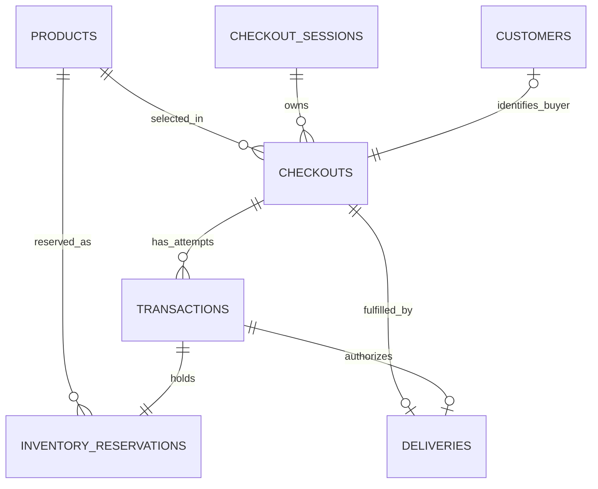

# Modelo de datos

**Persistencia implementada:** siete entidades TypeORM en infraestructura,
migración inicial y seed, verificados en PostgreSQL aislado y aplicados localmente.
Lectura del catálogo implementada; escrituras y coordinación de compra/pagos
siguen pendientes.
Una compra contiene un producto y cantidad; puede
conservar varios intentos de pago, solo uno activo. Ver [flujo](checkout-flow.md)
y [API](api-contract.md).

## Relaciones

## Convenciones

UUID v4 como PK; todas las tablas tienen `id` y `created_at timestamptz`.
Todas incluyen `updated_at` como metadato de persistencia. Fechas API UTC ISO 8601, FK con
ON DELETE RESTRICT. En las tablas, `?` indica NULL permitido; el resto es
obligatorio. Estados como varchar con CHECK. Los IDs del proveedor son opacos.

Importes integer en **centavos**, moneda COP. Cada importe y total calculado
está entre 0 y 2 000 000 000; precio y total deben ser positivos. El límite cabe
exactamente en PostgreSQL integer y TypeScript number. Multiplicar/sumar con
bigint transitorio o comprobaciones de entero seguro antes de convertir; no
serializar bigint ni usar float para dinero. Cantidad 1..99. El rango efectivo
además respetará límites de UAT, todavía por verificar.

## Tablas relevantes

### Catálogo y compra

| Tabla / propietario            | Campos relevantes                                                                                                                                                                | Integridad                                                                                   |
| ------------------------------ | -------------------------------------------------------------------------------------------------------------------------------------------------------------------------------- | -------------------------------------------------------------------------------------------- |
| `products` / Catalog           | sku varchar(64), category varchar(32) ?, name varchar(120), description text, image_url varchar(2048), unit_price_cents integer, currency char(3), stock integer, active boolean | UNIQUE sku; stock 0..1000000; precio positivo; currency=COP; imagen HTTPS controlada         |
| `checkout_sessions` / Checkout | token_digest bytea, expires_at timestamptz                                                                                                                                       | UNIQUE token_digest; digest de token aleatorio de 256 bits; cookie, no bearer en claro en DB |
| `customers` / Checkout         | full_name varchar(120), email varchar(254), phone varchar(16)                                                                                                                    | Cliente específico de una compra; no identidad global ni UNIQUE email                        |
| `checkouts` / Checkout         | session_id FK, product_id FK, customer_id FK ?, quantity smallint, delivery_draft jsonb ?, status varchar(32)                                                                    | UNIQUE customer_id; estados DRAFT/PAYMENT_PENDING/PAID; índice session_id                    |

El comprador y destino se completan antes de crear un intento. delivery_draft
contiene destinatario, teléfono, dirección, ciudad, región, país CO y campos
opcionales de complemento/código postal; no acepta JSON arbitrario. No hay CRUD administrativos
de clientes ni catálogo. Durante DRAFT se permite guardar cantidad, comprador y
destino; producto distinto implica otra compra. Dos ediciones DRAFT usan última
escritura válida: no se promete edición colaborativa ni detección de cada cambio
entre pestañas. PATCH y creación de intento se serializan bloqueando checkout;
una vez PAYMENT_PENDING ninguna edición puede modificar el intento.

### `transactions` / Checkout: un intento de pago

| Grupo        | Campos                                                                                                                                                                                                                               | Integridad                                                                              |
| ------------ | ------------------------------------------------------------------------------------------------------------------------------------------------------------------------------------------------------------------------------------ | --------------------------------------------------------------------------------------- |
| Identidad    | checkout_id FK, attempt_number integer, reference varchar(64)                                                                                                                                                                        | UNIQUE(checkout_id, attempt_number), UNIQUE reference                                   |
| Idempotencia | idempotency_key uuid, create_request_hash char(64), pay_request_hash char(64) ?                                                                                                                                                      | UNIQUE(checkout_id, idempotency_key); hashes de entrada normalizada, sin guardar tokens |
| Resultado    | status varchar(32), dispatch_status varchar(32), last_error_code varchar(64) ?                                                                                                                                                       | Estados y combinaciones del flujo; errores seguros propios                              |
| Proveedor    | provider_transaction_id varchar(128) ?, provider_environment varchar(16)                                                                                                                                                             | UNIQUE(provider_environment, provider_transaction_id); UAT_SANDBOX                      |
| Histórico    | product_id FK, product_name varchar(120), product_description text, quantity smallint, unit_price_cents integer, base_fee_cents integer, delivery_fee_cents integer, currency char(3), buyer_snapshot jsonb, delivery_snapshot jsonb | Información congelada al crear el intento; solo datos necesarios de comprador/destino   |
| Aceptaciones | acceptance_evidence jsonb ?                                                                                                                                                                                                          | Tipos/URLs de contratos, digests y fecha de aceptación explícita, sin tokens en claro   |
| Fechas       | submission_started_at timestamptz ?, finalized_at timestamptz ?                                                                                                                                                                      | Inicio antes de HTTP; finalized_at solo terminal                                        |

No duplicar los importes en otro snapshot JSON ni guardar un total independiente:
`total = quantity × unit_price_cents + base_fee_cents + delivery_fee_cents`.
Una función Money compartida lo calcula y valida; SQL usa casts a bigint para
el CHECK del límite. El importe del proveedor debe coincidir con ese total.
Copiar nombre/descripción y comprador/destino sí es necesario: no deben cambiar
con futuras ediciones del catálogo o borrador.

Índices únicos parciales por checkout: uno WHERE status='PENDING' y otro WHERE
status='APPROVED'. Índice `(checkout_id, created_at)` para el historial. Los
futuros repositorios solo deberán cambiar estado/identificador del proveedor,
no campos históricos. Esa inmutabilidad de aplicación todavía no está
implementada; las entidades no impiden editar esos campos con TypeORM/SQL.
No se añaden triggers ni rutas administrativas; separar rol de migración y rol
sin DDL al desplegar. Los CHECKs actuales validan límites, JSON de tipo objeto,
hashes y combinaciones de estado/envío/fechas; no sustituyen DTOs ni validación
del contenido de comprador/destino.

### Reservas y entregas

| Tabla / propietario                | Campos relevantes                                                                               | Integridad                                                                                                             |
| ---------------------------------- | ----------------------------------------------------------------------------------------------- | ---------------------------------------------------------------------------------------------------------------------- |
| `inventory_reservations` / Catalog | transaction_id FK, product_id FK, quantity smallint, status varchar(16), expires_at timestamptz | UNIQUE transaction_id; HELD/CONFIRMED/RELEASED; índice `(product_id, status)`                                          |
| `deliveries` / Fulfillment         | checkout_id FK, transaction_id FK, status varchar(16)                                           | UNIQUE checkout_id y transaction_id; estado READY; FK compuesto (transaction_id, checkout_id) al intento de esa compra |

Regla para los futuros casos de uso: intento y reserva se crearán en el mismo
commit. Entrega solo deberá existir con
aprobación, en el mismo commit que confirma inventario. Su producto/destino
histórico se obtiene del intento: no se copia otra vez. READY significa lista
para entregar, no integración con transportista.

`products.stock` son unidades aún no vendidas. Disponible = stock menos la suma
de reservas HELD vigentes. Una HELD con envío NOT_SENT y expires_at vencido deja
de ocupar disponibilidad; si el envío es IN_FLIGHT/SUBMITTED/UNKNOWN, sigue
ocupándola **sin importar esa fecha**. La lectura del catálogo ya aplica esa regla; las futuras escrituras deberán
reutilizarla bajo bloqueo. Al aprobar se decrementa stock y se marca CONFIRMED; al rechazar se
marca RELEASED. No hay contador reserved duplicado ni tabla inventory separada.

Los futuros casos de creación de reserva e inicio/finalización bloquearán
products antes de evaluar capacidad. Todos los escritores seguirán checkout -> intento propio
(si existe) -> product -> reserva propia. Así dos compradores no reservan la
última unidad; no se bloquean compras ajenas para limpiar reservas vencidas.

category usa un CHECK con audio/computacion/accesorios/almacenamiento/
hogar-inteligente. NULL preserva registros ajenos sin asignarles una categoría
inventada; los diez productos del seed siempre tienen categoría. No hay tabla ni
CRUD adicional.

## Migración y seed implementados

- DataSource en `backend/src/infrastructure/database/data-source.ts`; opciones
  compartidas con NestJS, validación existente y synchronize/migrationsRun=false.
- Inicial `1795632838292-InitialSchema.ts`: siete tablas, FKs RESTRICT, CHECKs e
  índices. FKs compuestas vinculan entrega a su compra y reserva al producto y
  cantidad de su intento. Aprobación/stock/entrega en un commit requieren todavía
  la UoW de aplicación: las FKs por sí solas no lo garantizan.
- AddProductCategory1795643379559 añade el campo nullable y su CHECK. Migra una
  sola vez los dos originales a AUD-001/AUD-002 si sus datos coinciden con la
  versión original; preserva UUID, stock, reservas y snapshots. Si fueron
  personalizados, CATALOG_TRANSITION_CONFLICT aborta con rollback completo.
  No se editó InitialSchema. El down elimina categoría, no revierte presentación.
- Seed con diez IDs/SKUs fijos y ON CONFLICT DO NOTHING en una transacción.
  Repetirlo preserva stock consumido, productos ajenos y ediciones posteriores,
  incluso cambios posteriores de SKU. No se vuelve a ejecutar la transformación
  como parte del seed: queda registrada por el historial de migraciones.
- [Comandos reales en README](../README.md#migraciones-y-seed). La prueba
  `npm run test:integration` crea una DB aleatoria aislada, verifica up/down/up,
  equivalencia ORM/esquema, seed repetido, límites, FKs e índices concurrentes.
  Necesita CREATEDB en el servidor local y borra solo su propia base temporal.
  Verificado con CLI Node en Windows y PostgreSQL 17 en Docker Linux; ejecución
  de la CLI en Linux pendiente. La DB local ya tiene ambas migraciones y los diez productos;
  repetir el seed conservó íntegramente las filas existentes.

Solo datos ficticios en sandbox. No se incluye un sistema de retención o
anonimización en este assessment; antes de usar datos reales se requiere definir
retención, acceso, copias de seguridad y borrado. No se presenta esa necesidad
como resuelta por omitirla del alcance.
